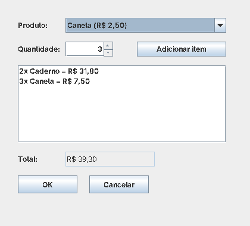
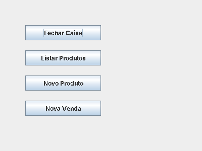
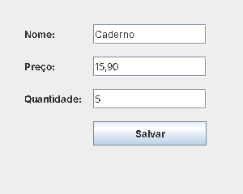
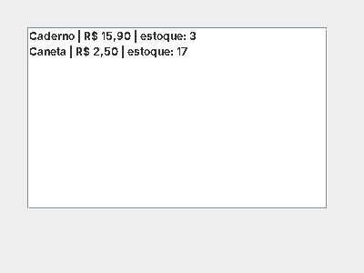

# Loja: sistema de vendas em Java Swing

Aplicação desktop para cadastrar produtos, controlar estoque e registrar vendas, construída em Java puro com Swing e arquitetura MVC.

[](https://github.com/lbraz55/encapsulamento/actions/workflows/build.yml)


[](LICENSE)

<p align="center">
  
</p>

## Sobre o projeto

Este projeto nasceu em 2024 como trabalho da faculdade, numa disciplina de Programação Orientada a Objetos. O objetivo era praticar **encapsulamento** (daí o nome do repositório) e a separação de responsabilidades entre modelo, interface e controle.

Na época, o código foi publicado de um jeito pouco ortodoxo: todas as classes estavam coladas dentro do `README.md`. Algumas apareciam duplicadas, e havia trechos que não compilavam. Depois, o repositório foi reorganizado como um projeto Maven de verdade. O código foi extraído, as duplicatas foram resolvidas, as partes que eram só esboço foram implementadas e foram adicionados testes e integração contínua. Os nomes de classes, pacotes e métodos da versão original foram mantidos, para que dê para reconhecer o trabalho de faculdade dentro da versão atual.

## Funcionalidades implementadas

- **Cadastro de produtos** com nome, preço e quantidade inicial em estoque. Preço aceita vírgula ou ponto (`15,90` ou `15.90`).
- **Listagem de produtos** com preço formatado em reais e estoque atual.
- **Registro de vendas com vários itens**: escolha do produto, quantidade, lista de itens e total calculado automaticamente.
- **Controle de estoque**: a venda só é concluída se houver estoque para todos os itens, e a baixa é feita de uma vez só. Se algum item falhar, nada é alterado.
- **Numeração sequencial das vendas** (#1, #2, ...).
- **Fechamento de caixa** com resumo da quantidade de vendas e do valor total antes de encerrar.
- **Validação de entrada** com mensagens de erro em vez de exceções na cara do usuário.

| Menu principal | Cadastro de produto | Lista de produtos |
|:---:|:---:|:---:|
|  |  |  |

## Stack e dependências

| Tecnologia | Versão | Uso |
|---|---|---|
| Java (OpenJDK) | 17+ | Linguagem |
| Swing (`javax.swing`) | parte do JDK | Interface gráfica |
| Maven | 3.6+ | Build, testes e empacotamento |
| JUnit Jupiter | 5.10 | Testes unitários (só em escopo de teste) |
| GitHub Actions | — | CI: roda `mvn verify` a cada push |

Em tempo de execução, o projeto não tem **nenhuma dependência externa**: só usa o JDK.

## Arquitetura e organização do projeto

O código segue o padrão **MVC**, com um pacote para cada camada:

```text
encapsulamento/
├── .github/workflows/build.yml      # Pipeline de CI (compila e testa)
├── docs/img/                        # Capturas de tela usadas neste README
├── src/
│   ├── main/java/
│   │   ├── app/
│   │   │   └── Main.java            # Ponto de entrada: inicia a interface na thread do Swing
│   │   ├── controller/
│   │   │   └── Controlador.java     # Regras da loja (cadastro, estoque, vendas) e navegação entre telas
│   │   ├── model/
│   │   │   ├── Produto.java         # Produto: nome, preço e quantidade em estoque
│   │   │   ├── ProdutoVendido.java  # Item de venda: produto, quantidade e subtotal
│   │   │   ├── Venda.java           # Venda: id, itens e total
│   │   │   └── LVenda.java          # Coleção das vendas realizadas
│   │   └── view/
│   │       ├── LojaFrame.java       # Menu principal
│   │       ├── ProdutoFrame.java    # Formulário de cadastro de produto
│   │       ├── ListaProdutosFrame.java
│   │       ├── VendaFrame.java      # Montagem e confirmação de uma venda
│   │       └── Formato.java         # Formatação de moeda (R$) e leitura de decimais
│   └── test/java/
│       └── controller/
│           └── ControladorTest.java # Testes da lógica de cadastro, venda e estoque
├── pom.xml
└── LICENSE
```

O fluxo é simples. As telas (`view`) só capturam a entrada do usuário e mostram resultados. Toda regra de negócio (validar dados, conferir estoque, dar baixa, numerar vendas) fica no `Controlador`. As classes de `model` guardam o estado com atributos privados, acessados por getters e setters.

```text
 Usuário ──► view (JFrame) ──► Controlador ──► model (Produto, Venda, LVenda)
                 ▲                  │
                 └──── dados ◄──────┘
```

Um detalhe importante: o `Controlador` só cria as janelas em `iniciarLoja()`. Assim, a lógica pode ser usada e testada sem abrir interface gráfica nenhuma, o que é essencial para os testes rodarem no CI, onde não existe tela.

## Como executar

### Pré-requisitos

- **JDK 17** ou superior (`java -version`)
- **Maven 3.6** ou superior (`mvn -version`)
- Um ambiente com interface gráfica. O Swing não roda em terminal puro ou num servidor sem display.

### Passo a passo

1. Clone o repositório:

   ```bash
   git clone https://github.com/lbraz55/encapsulamento.git
   ```

2. Entre na pasta do projeto:

   ```bash
   cd encapsulamento
   ```

3. Compile, rode os testes e gere o `.jar`:

   ```bash
   mvn package
   ```

4. Execute a aplicação:

   ```bash
   java -jar target/loja.jar
   ```

Se preferir rodar só os testes:

```bash
mvn test
```

Para rodar pela IDE (IntelliJ, Eclipse ou VS Code), importe a pasta como projeto Maven e execute a classe `app.Main`.

### Roteiro rápido de uso

1. **Novo Produto** → cadastre, por exemplo, `Caderno`, `15,90`, quantidade `5`.
2. **Listar Produtos** → confira o produto e o estoque.
3. **Nova Venda** → escolha o produto, defina a quantidade, clique em **Adicionar item** e depois em **OK**.
4. **Listar Produtos** de novo → o estoque já aparece descontado.
5. **Fechar Caixa** → mostra o resumo das vendas e encerra a aplicação.

## Decisões técnicas e trade-offs

| Decisão | Por quê | Custo / limitação |
|---|---|---|
| **Dados só em memória** | O escopo original era exercitar POO, não persistência. Assim o projeto roda sem banco nem configuração nenhuma. | Ao fechar a aplicação, tudo se perde. |
| **Swing puro, sem frameworks** | Vem com o JDK, não exige dependências e era o que a disciplina usava. | Visual datado e menos produtivo que JavaFX ou uma interface web. |
| **`setLayout(null)` com posições fixas** | Mantido do código original. É fácil de entender e de posicionar componentes. | As janelas não se adaptam a redimensionamento nem a fontes maiores. Um gerenciador de layout (`GridBagLayout`, `MigLayout`) seria o correto. |
| **`double` para valores monetários** | Mantido do modelo original pela simplicidade. | `double` tem erros de arredondamento. Em produção, o certo é `BigDecimal`. |
| **Id do produto = posição na lista** | O método `postQuantidade(int idProduto, ...)` já existia e esperava um id, mas `Produto` não tem esse campo. Usar o índice resolveu sem mudar o modelo. | Remover produtos quebraria os ids. Um campo `id` próprio seria mais robusto. |
| **API pública com arrays (`Produto[]`, `Venda[]`)** | Preserva as assinaturas originais do `Controlador`. Por dentro, ele usa `List`. | Mistura de estilos: o model usa `List`, a API do controlador devolve arrays. |
| **Pacotes `model`/`view`/`controller` sem domínio reverso** | Fidelidade ao trabalho original e leitura imediata do MVC. | O padrão Java seria algo como `br.com.autor.loja.model`. |
| **Getters e setters para todos os atributos** | Era a forma de encapsulamento ensinada na disciplina. | Setters irrestritos enfraquecem o encapsulamento. Por exemplo, `ProdutoVendido.setPrecoTotal` permite um subtotal inconsistente com preço × quantidade. Tornar alguns objetos imutáveis seria um passo natural. |
| **Total da venda calculado na tela** | A `VendaFrame` soma os subtotais dos itens antes de criar a `Venda`, como no fluxo original. | O controlador confia no total recebido. O ideal seria ele mesmo calcular. |
| **Testes só na camada de controle** | É onde está a lógica que pode quebrar. Testar a interface Swing exigiria ferramentas extras e daria pouco retorno aqui. | As telas foram validadas só manualmente. |

## O que ficou de fora / próximos passos

- [ ] **Persistência**, com SQLite via JDBC ou um simples arquivo JSON/CSV.
- [ ] **Editar e remover produtos**, além de dar entrada de estoque em produtos já cadastrados.
- [ ] **Tela de histórico de vendas**, com detalhes dos itens de cada venda.
- [ ] Trocar `double` por **`BigDecimal`** nos valores monetários.
- [ ] Dar um **`id` próprio** a `Produto` e mover o cálculo do total para o controlador.
- [ ] Substituir o layout absoluto por um **gerenciador de layout** responsivo.
- [ ] Reduzir setters e tornar `ProdutoVendido` e `Venda` **imutáveis** depois de criados.
- [ ] Testes de interface (por exemplo, com AssertJ Swing).

## Aprendizados

- **Encapsulamento na prática**: atributos privados com acesso controlado são o ponto de partida. Mas também ficou claro que gerar getters e setters para tudo não é, por si só, encapsular. O objeto precisa proteger as próprias regras.
- **MVC e separação de responsabilidades**: manter a regra de negócio fora das telas foi o que permitiu testar a lógica sem abrir nenhuma janela.
- **Construção de interfaces com Swing**: eventos, `JFrame`, componentes, e o cuidado de criar a interface na *Event Dispatch Thread*.
- **Organização e versionamento**: colar o código no README funcionou para entregar o trabalho, mas não funciona como projeto. Reorganizar este repositório (build reproduzível, testes, CI e documentação) foi, por si só, um aprendizado sobre como apresentar código.

## Licença

Distribuído sob a licença MIT. Veja o arquivo [LICENSE](LICENSE) para mais detalhes.

## Autor

**Gleysson Luís Braz**

- E-mail: [gleyssonluis3@gmail.com](mailto:gleyssonluis3@gmail.com)
- LinkedIn: [Gleysson Luís Braz](https://www.linkedin.com/in/gleysson-lu%C3%ADs-braz-gomes-oliveira-119638244/)
- GitHub: [@lbraz55](https://github.com/lbraz55)
